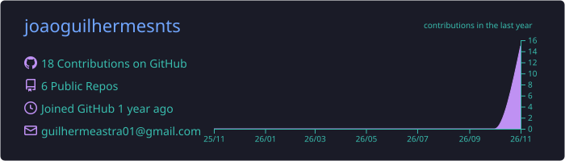
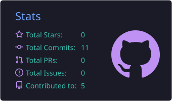
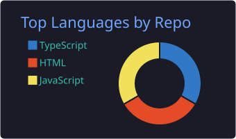
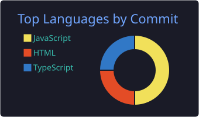
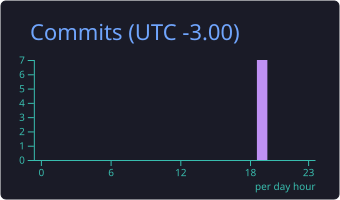

<!-- ═══════════════ BANNER ═══════════════ -->

  

<!-- ═══════════════ APRESENTAÇÃO ═══════════════ -->
<h1 align="center">Oi 👋, eu sou o Guilherme</h1>

<h3 align="center">Full-Stack Developer</h3>

  

  Construindo sistemas confiáveis, com arquitetura limpa e soluções escaláveis, do front ao back.

---

<!-- ═══════════════ SOBRE MIM ═══════════════ -->
## 🚀 Sobre mim

<table>
  <tr>
    <td valign="top" width="65%">

**Guilherme** aqui — estudante de Análise e Desenvolvimento de Sistemas, focado em desenvolvimento full-stack.

Gosto de construir aplicações e APIs escaláveis e prontas para produção, com Python e C#, e estou sempre aprofundando meu entendimento de sistemas reais.

Atualmente estou aprendendo **Machine Learning**, **PostgreSQL**, **C#**, **Docker** e **MySQL**, enquanto afio minha lógica com **Estruturas de Dados e Algoritmos**.

Meu objetivo é simples: escrever código limpo, construir software confiável e me tornar um desenvolvedor de software que cria sistemas duradouros e seguros.

  </td>
    <td align="center" valign="middle" width="35%">
      
    </td>
  </tr>
</table>

---

<!-- ═══════════════ CONTATO ═══════════════ -->
## 🤝 Connect

  
  &nbsp;
  

---

<!-- ═══════════════ TECH STACK ═══════════════ -->
## 💻 Tech Stack

  

---

<!-- ═══════════════ GITHUB STATS ═══════════════ -->
## 📊 GitHub Stats

  

  
  

---

<!-- ═══════════════ ATIVIDADE ═══════════════ -->
## 📈 Atividade

  
  

  

<!-- ═══════════════ RODAPÉ ═══════════════ -->

  

